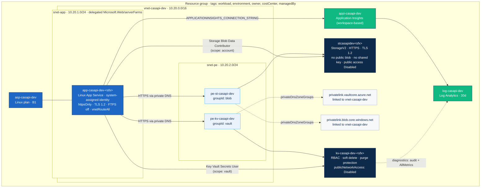

# Environment architecture — `casapi` / `dev`

Generated from `infra/main.bicep` and `infra/modules/*.bicep`. Node labels are the `names` variable
values with `workload = casapi`, `environment = dev`; `<sfx>` is `take(uniqueString(resourceGroup().id), 6)`.

## Reading the diagram

| Edge | Source of truth |
|---|---|
| App → private endpoints → data services | `app.bicep` (`virtualNetworkSubnetId`, `vnetRouteAllEnabled`), `private-endpoint.bicep` |
| Private endpoints → DNS zones | `private-endpoint.bicep` (`privateDnsZoneGroups`), `network.bicep` (zones + links) |
| Role edges | `rbac-keyvault.bicep`, `rbac-storage.bicep` (`scope:` on the target resource) |
| Telemetry | `app.bicep` app settings, `monitoring.bicep`, `keyvault.bicep` diagnostics |

> **Assumption:** The App Service is shown without an inbound private endpoint because
> `appPublicNetworkAccess = 'Enabled'` in `dev.bicepparam` (ADR-001). Nothing here reflects a deployed
> environment; it is derived from source only.
